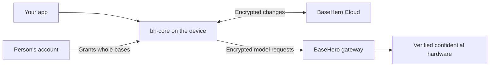

# Build an app on BaseHero

## What you get

Your app embeds `bh-core` to keep records on the device, sync encrypted changes through BaseHero Cloud, and call a model through BaseHero's gateway. A person grants an app access to whole bases. The core opens only the bases granted to that app. Stored data is encrypted on devices; model requests are encrypted on the device for the provider's verified confidential hardware.



## Add the core

Pin a release tag in your `Cargo.toml`. Use the [latest release](https://github.com/BaseHero/basehero/releases/latest) in place of `vX.Y.Z`; each release's guide matches its tag.

```toml
[dependencies]
bh-core = { git = "https://github.com/BaseHero/basehero", tag = "vX.Y.Z" }
serde_json = "1"
zeroize = "1"
```

Use Rust 1.99 or later, `pkg-config`, Perl (for the OpenSSL built with SQLCipher), and libsodium 1.0.22 or later. Install libsodium where `pkg-config` can find it. For a Nix host build, the published flake exposes `libsodium`. For Android it also exposes `libsodiumAndroidAarch64` and `libsodiumAndroidX86_64` on Linux. Build or select static libsodium for the target and set `LIBSODIUM_STATIC=1`. BaseHero's Android shell uses NDK 29, API 24 and these target-specific variables (replace `SODIUM` with the chosen target library path, and set `NDK_HOME` to your NDK):

```sh
export PKG_CONFIG_LIBDIR_aarch64_linux_android="$SODIUM/lib/pkgconfig"
export PKG_CONFIG_ALLOW_CROSS_aarch64_linux_android=1
export PKG_CONFIG_PATH_aarch64_linux_android=""
export CC_aarch64_linux_android="$NDK_HOME/toolchains/llvm/prebuilt/linux-x86_64/bin/aarch64-linux-android24-clang"
export AR_aarch64_linux_android="$NDK_HOME/toolchains/llvm/prebuilt/linux-x86_64/bin/llvm-ar"
export LIBSODIUM_STATIC=1
```

For an x86_64 emulator, select `libsodiumAndroidX86_64` and set the corresponding variables:

```sh
export PKG_CONFIG_LIBDIR_x86_64_linux_android="$SODIUM/lib/pkgconfig"
export PKG_CONFIG_ALLOW_CROSS_x86_64_linux_android=1
export PKG_CONFIG_PATH_x86_64_linux_android=""
export CC_x86_64_linux_android="$NDK_HOME/toolchains/llvm/prebuilt/linux-x86_64/bin/x86_64-linux-android24-clang"
export AR_x86_64_linux_android="$NDK_HOME/toolchains/llvm/prebuilt/linux-x86_64/bin/llvm-ar"
export LIBSODIUM_STATIC=1
```

The empty target `PKG_CONFIG_PATH` keeps host libraries out of the cross build.

The core links SQLCipher through `rusqlite` 0.41. A Rust binary can link only one SQLite library. If your app also uses `rusqlite`, use 0.41; an app database opened without a key remains a plain SQLite file. Some transitive dependencies are pinned exactly; let Cargo resolve the tag's dependency graph rather than overriding its pins. Never enable the `bh-core/test-support` feature in a shipped app.

## Open the core

Give each installation its own data directory and keep it out of device backups. On Android, disable backup or exclude both the database and sealed-secret directories. Keep a random 32-byte sealing key that the platform protects: on Android, wrap it with an Android Keystore key and store the wrapped copy outside backups; on macOS, keep it in the Keychain. Pass that key to `SealedFileSecretStore`, and reuse the same key after a restart. Losing it makes the sealed local secrets unreadable, and the device must connect again. Only one open core may use a data directory at a time.

```rust
use bh_core::{Core, CoreConfig, Error, SealedFileSecretStore};
use std::{path::PathBuf, sync::Arc};
use zeroize::Zeroizing;

fn open(data_dir: PathBuf, platform_key: Zeroizing<[u8; 32]>) -> Result<Core, Error> {
    let secrets = Arc::new(SealedFileSecretStore::new(
        data_dir.join("secrets"), platform_key,
    )?);
    Core::open(CoreConfig { data_dir, secrets })
}
```

Call `Core::shutdown()` as the app quits. The core also stops when its last handle drops.

## Connect

**Android:** How apps connect on Android is being finalised. Do not build against an Android connection contract yet.

For development on a desktop, use a full device signed into the `dev` environment to create a base and issue app credentials. The current `bh app connect` takes one base, either an existing base by ID or name (`--base`) or a new base (`--new-base`). It does not accept an app ID or reconnect an existing app; a fresh connection is a new app device.

```sh
bh app connect --name "Developer - Example" --new-base "Example data" --out app-credentials.json
```

Choose `--read-only` for an app that must not write. Use a **different** data directory for the app than the full device's CLI home. The credentials file contains a bearer token and an app key; read it in native code, install it once, and delete the file. Never put it in a WebView, a log, a repository or a backup. Its `bases` array holds the granted base IDs in request order.

```rust,no_run
use bh_core::{AppCredentials, Core, Error};
use std::{fs, path::Path};

async fn install(core: &Core, path: &Path) -> Result<(), Box<dyn std::error::Error>> {
    let credentials: AppCredentials = serde_json::from_slice(&fs::read(path)?)?;
    let base_ids = credentials.bases.clone();
    let account = core.install_app(credentials).await?;
    fs::remove_file(path)?;
    for id in base_ids {
        let _base = account.base(id)?;
    }
    Ok(())
}
```

`Core::install_app` needs the network. On later launches, `Core::open` loads the installed account; use `core.accounts()` and `core.account(id)` rather than installing again. If `AccountEvent::Removed` arrives, the core has erased its local account copy. Stop using its base handles and ask the person to connect again.

## What your app can see

An app device has access to **all records** in each granted base, including notes and records written by other apps. It cannot open ungranted bases. Each grant is `Mode::ReadOnly` or `Mode::ReadWrite`; local edits to a read-only base return `Error::ReadOnly`. A full device connecting the app chooses its display name; for example, `Developer - Example`. No narrower folder grant is available in this API.

## Record types

Define a `TypeDef` in every writable base your app uses, each time it opens that base. Use a namespace such as `example.reading`; `core.` is reserved. A definition has a name, version, description (`doc`), an optional `title_field`, and `FieldDef` entries. `title_field` must name a `Text` field. Put useful descriptions in `doc`: Hero can read them.

```rust
use bh_core::{Base, Error, FieldDef, FieldKind, TypeDef};

fn define_reading(base: &Base) -> Result<(), Error> {
    base.define_type(TypeDef {
        name: "example.reading".into(),
        version: 1,
        doc: "One day's measured value".into(),
        title_field: None,
        fields: vec![
            FieldDef { name: "day".into(), kind: FieldKind::Date,
                required: true, unit: None, doc: "Calendar day".into() },
            FieldDef { name: "value".into(), kind: FieldKind::Number,
                required: true, unit: Some("count".into()),
                doc: "Measured count".into() },
            FieldDef { name: "note".into(), kind: FieldKind::Text,
                required: false, unit: None, doc: "Optional note".into() },
        ],
    })
}
```

| Kind | JSON value |
| --- | --- |
| `Text` | string |
| `Number` | number |
| `Integer` | integer |
| `Bool` | boolean |
| `Date` | real calendar date as `"YYYY-MM-DD"` |
| `DateTime` | RFC 3339 string with an offset, such as `"2026-11-01T10:00:00Z"` |
| `Ref` | lowercase, 32-hex-character object ID string |
| `Json` | any JSON value |
| `Secret` | string; not indexed for search or exposed by Hero's tools |

`unit` describes a measurement and is part of a field's meaning. An existing version may gain optional fields or change `doc` text; do not change a field's kind, requirement, meaning or unit. For a breaking change, use a new field or a new version for new records. Old records are not rewritten. `query` includes all stored versions, so read every version your app has written. Handle `Error::NeedsUpdate` or `BaseEvent::NeedsUpdate` when a newer client is required. Unknown fields remain in stored records.

## Write and query records

`Base::create`, `set_fields`, `get` and `delete` work on local records; `delete` moves a record to the trash. Filters are combined with AND. `Query::ty` selects a type name across its versions. A record has a stable `ObjectId` and JSON `fields`.

For a daily measurement, keep one record per day. After connecting, wait until `base.sync_state().last_synced_at` is `Some` before querying for that day. Otherwise a reinstalled app may create a duplicate before it has fetched the old record. Then update the match, or create it if none exists:

```rust
use bh_core::{Base, Error, Filter, NewObject, Op, Order, Query, TypeRef};
use serde_json::{Map, json};

fn write_reading(base: &Base, day: &str, value: f64) -> Result<(), Error> {
    let query = Query {
        ty: "example.reading".into(),
        filters: vec![Filter { field: "day".into(), op: Op::Eq, value: json!(day) }],
        order_by: Some(("day".into(), Order::Desc)),
        limit: Some(1),
    };
    let mut fields = Map::new();
    fields.insert("value".into(), json!(value));
    if let Some(found) = base.query(&query)?.first() {
        base.set_fields(found.id, fields)?;
        let _latest = base.get(found.id)?;
    } else {
        fields.insert("day".into(), json!(day));
        let id = base.create(NewObject {
            ty: TypeRef::new("example.reading", 1),
            parent: None, after: None, fields,
        })?;
        let _created = base.get(id)?;
    }
    Ok(())
}
```

Validate `day` before writing; the type checks that it is a calendar date. `set_fields` changes only the supplied fields, and a JSON `null` removes a field. Subscribe to `base.events()` to refresh views after `BaseEvent::ObjectsChanged`. If the receiver lags, reload from the base instead of assuming that every event arrived.

## Sync and offline

Writes commit locally and return immediately. The core queues changes and syncs when online. `base.sync_state()` reports the pending count, connection status and last completed catch-up; `base.flush().await` waits for the local outbox to reach the server. `Base::events` reports local and fetched object changes and sync state. A flush is **not** a substitute for waiting for the first catch-up before a query-and-create operation.

When two devices change the same field at once, every device ends up with one of the two values. Do not rely on a cross-field rule still holding after a merge; validate it when reading. Each sealed change must fit within 8 MiB. Keep daily records well under 1 MiB.

## Bulk data

Use one record per day, not one per measurement. Keep a bounded set of samples in a `Json` field when it fits comfortably below the change limit. Files aren't in the API yet.

## Models

`account.model()` returns a `ChatModel` for calls without a base. Use `account.model_for(base_id)` to attribute calls to a granted base; it refuses a base this device cannot open, and the gateway checks the grant again before forwarding each call. `complete` takes a `ChatRequest` and returns a `Completion` with optional text, tool calls and usage. It needs the network. The core uses the app device's token through BaseHero Cloud; the app does not need a model API key. The request is encrypted on the device for the provider's verified hardware. Handle `ModelError` separately from core `Error`, including `RateLimited`, `Verification`, `Transport` and `NeedsUpdate`.

```rust,no_run
use bh_core::{Account, BaseId, models::{ChatRequest, Message, Role}};

async fn ask(account: &Account, base_id: BaseId, question: &str) -> Result<Option<String>, Box<dyn std::error::Error>> {
    let model = account.model_for(base_id)?;
    let reply = model.complete(ChatRequest {
        messages: vec![Message {
            role: Role::User, content: Some(question.into()),
            tool_calls: vec![], tool_call_id: None,
        }],
        tools: vec![], tool_choice: None, max_tokens: 64,
    }).await?;
    Ok(reply.text)
}
```

The gateway limits requests per account, shared across the account's devices. Calls beyond a limit return `ModelError::RateLimited`.

## Test against `dev`

Ask the BaseHero team for a `dev` invite. Install the CLI from the same release tag as your `bh-core`:

```sh
cargo install --locked --git https://github.com/BaseHero/basehero --tag vX.Y.Z bh-cli
```

Sign up a full device in `dev`, with its own CLI home, then connect your app. `bh signup` prompts for the account password unless `BH_PASSWORD` is set; keep the recovery kit it prints.

```sh
bh signup --server https://dev-api.basehero.com --invite "$INVITE" --email "$EMAIL" --name "Developer - Desktop"
bh app connect --name "Developer - Example" --new-base "Example data" --out app-credentials.json
```

Install the file in your app with `Core::install_app`, using the app's own data directory, then delete the file. To see what your app wrote, run `bh sync` and then `bh record query --type example.reading` on the full device. Develop and test against `dev`; production is for real use.

## Stability

The `/v1` protocol and stored data formats are versioned. Until 1.0, the Rust API can change in any release. Pin a release tag and read the matching API reference with `cargo doc -p bh-core --open` in your project. Update deliberately and test against `dev` before shipping.
